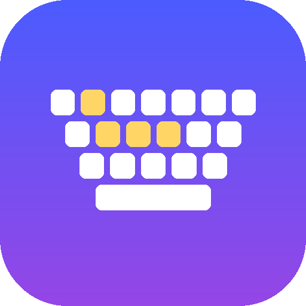

<p align="center"></p>

# LocalKeys

iPad как полноценная клавиатура, тачпад и игровой контроллер для компьютера с Windows.
Работает по **Wi-Fi** и по **USB-C кабелю**, сам находит компьютер и сам переключается между каналами.

## Возможности

- **Настоящая клавиатура, а не «отправка текста».** Передаются аппаратные скан-коды, поэтому работают все клавиши, любые сочетания, удержания, автоповтор и игры (DirectInput / Raw Input).
- **Честный мультитач.** Каждый палец отслеживается отдельно: можно держать W + Shift, жать Space и крутить камеру одновременно. Без залипаний: всё, что было нажато через пропавшее соединение, ПК отпускает сам.
- **Два канала одновременно.** По USB-кабелю ввод идёт по проводу (iPad заряжается, Wi-Fi не нужен), Wi-Fi держится в резерве и мгновенно подхватывает ввод, если кабель вынуть.
- **Раскладки:** «Ноутбук» (клавиатура + тачпад), полная клавиатура, «Игры» (WASD + зона обзора мышью), «Игры: стик» (виртуальный стик → WASD с бегом), тачпад, цифровой блок + медиа + F13–F24, «Команды» (копировать/вставить, скриншот, диспетчер задач…).
- **Редактор раскладок:** перетаскивание, изменение размера, любые клавиши, сочетания, кнопки мыши, колесо, ввод текста, фиксируемые клавиши (автобег), зоны тачпада/обзора, стики. Экспорт/импорт JSON.
- **Языки EN / RU / UA и любые другие:** подписи клавиш берутся из активной раскладки Windows, двуязычные подписи, кнопка 🌐 и выбор языка ПК прямо с iPad.
- **Тачпад:** ускорение, касание = клик, тап-и-тяни, два пальца = прокрутка с инерцией и правый клик, три = средний клик.
- **Ввод с клавиатуры iPad:** диктовка, свайп-набор, автокоррекция → текст уходит на ПК.

## Установка

### Windows
1. Скачайте `LocalKeys-Setup.exe` из [Releases](../../releases/latest) и установите.
2. Всё. Агент запускается вместе с Windows (через Планировщик задач с повышенными правами — без запроса UAC, зато ввод доходит до игр и окон администратора) и живёт в трее.
3. Для работы **по кабелю** нужна служба Apple Mobile Device: установите бесплатное приложение **Apple Devices** из Microsoft Store (или iTunes). Окно LocalKeys подскажет, если её нет.

### iPad (SideStore)
- Скачайте `LocalKeys.ipa` из [Releases](../../releases/latest) и установите через SideStore,
- или добавьте источник в SideStore для обновлений в один тап:
  `https://github.com/vanaedynak/LocalKeys/releases/latest/download/sidestore-source.json`

### Первое подключение
- **Wi-Fi:** откройте LocalKeys на iPad. Компьютер найдётся сам; подтвердите 6-значный код в окне на ПК (один раз).
- **USB-C:** подключите кабель, нажмите «Доверять» на iPad. Сопряжение по кабелю автоматическое и сразу работает и для Wi-Fi.

## Как это устроено

```
iPad (SwiftUI + UIKit multitouch)                 Windows (.NET 8, трей)
┌──────────────────────────┐   USB-C: usbmux    ┌───────────────────────────┐
│ KeyboardView: каждый     │ ◄───────────────── │ UsbMuxClient → 127.0.0.1: │
│ UITouch → своя клавиша   │   (порт 47811)     │ 27015 (Apple Mobile Dev.) │
│ InputController (счётчики│                    │                           │
│ удержаний, sticky-моды)  │   Wi-Fi: TCP       │ WifiServer :47810 + mDNS  │
│ ConnectionManager        │ ─────────────────► │ AgentCore → DeviceInput   │
│  USB приоритетнее Wi-Fi, │   Bonjour          │  → SendInput (скан-коды), │
│  StateSync при смене     │   _localkeys._tcp  │    автоповтор, LayoutMon. │
└──────────────────────────┘                    └───────────────────────────┘
```

- Протокол: кадры `[u16 длина][u8 тип][данные]`, нажатия — 5 байт, TCP_NODELAY, класс трафика Wi-Fi «голос» (WMM AC_VO).
- Безопасность: по Wi-Fi подключаются только сопряжённые iPad (код подтверждения + токен), USB-порт на iPad принимает только loopback-соединения от usbmux.

## Ограничения (Windows/iPadOS)
- Ctrl+Alt+Del, экран блокировки и окна UAC не принимают программный ввод — это защита Windows.
- Игры с драйверным античитом (Vanguard и т.п.) могут игнорировать эмулированный ввод.
- Жесты iPad 4–5 пальцами лучше отключить: Настройки → Экран «Домой» и многозадачность → Жесты, или включить «Гид-доступ».

## Сборка
Всё собирается в GitHub Actions (`.github/workflows/build.yml`): iOS — XcodeGen + xcodebuild без подписи → IPA; Windows — `dotnet publish` (self-contained) + Inno Setup. Тег `v*` публикует релиз с IPA, установщиком и источником SideStore.
